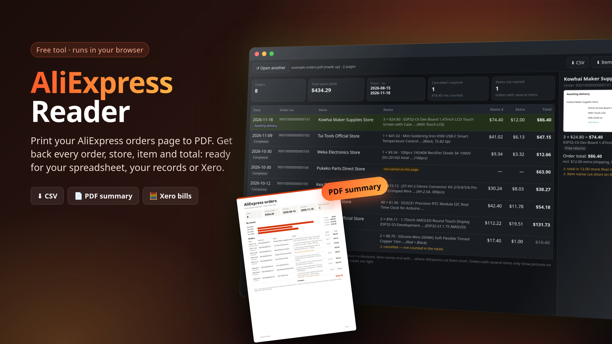

# AliExpress Reader

Pulls the orders out of a printed AliExpress **Orders** page and saves them in the same shapes Statement Teacher
exports, so Statement Teacher / Money Trail can take them in later.

## Use
1. On AliExpress: Account → **Orders** → scroll down until every order you want has loaded → Ctrl+P → **Save as PDF**.
2. `./start.sh`, open http://127.0.0.1:8835 → 📂 Open a PDF (or drop it on the page).
3. Click an order to see its spot on the page. **⬇ CSV** = one row per order (opens in a spreadsheet); **⬇ PDF summary** =
   a printable page: totals, by month, every order. **💾 Export for Statement Teacher** → `~/Documents/AliExpress Reader exports/<name> <date>/`.

Command line: `python3 reader.py file.pdf` (print) · `--json` · `--export DIR`.

## Two versions
- **Website tool** (`web/`): runs in the browser, the PDF is never uploaded. Live at testtagrepair.co.nz/aliexpress-reader
  (copied into the website's `public/tools/aliexpress-reader/`). pdf.js + jsPDF bundled in `web/vendor/` (Apache-2.0 / MIT).
  Same rules as the Python reader: `tests/test_xero_and_web.py` checks both give the same answers.
- **PC app** (`server.py`, :8835): the same, plus the Statement Teacher export.

## Xero
⬇ Xero → each paid order = one **Draft bill** from contact "AliExpress", invoice number = order number, date = due date =
order date. Lines = items + a "Shipping, GST and fees" (or "Discount") line so each bill adds up to the card charge.
Cancelled/expired orders are left out. Settings: contact name, account code (default 300), GST (default No GST; or
GST on Expenses, tax inclusive). **Bills CSV** = Xero's bill import (Business → Bills to pay → Import); check the columns
against Xero's own template the first time. **Xero API (JSON)** = body for `POST /api.xro/2.0/Invoices` (Type ACCPAY).

## What it reads
Per order: date, order number (Ref. Number), status, store, total (+ currency), and each item shown: name (as cut
short by AliExpress, ends with …), option, unit price × qty, small print (coupon / free returns).
**Extra** = total − items shown = shipping, GST, fees (minus = discount).
**Cancelled / Closed / Refunded / Expired** orders are listed but left out of every total. Refund lines ("Refund complete…")
are kept with the order and flagged. AliExpress's "More to love" suggestions after the last order are ignored.
Orders with several items show **no item names** on the Orders page → flagged `itemsnotlisted`; the total is still right.

Needs: Python 3, poppler-utils (`pdftotext`, `pdftoppm`), pycairo (`python3-cairo`). No OCR and no AI: word positions from poppler `pdftotext -bbox-layout`. The side menu (left of the status column)
and the Total/buttons column are kept out by position.

## Export files (money in cents in .json, dollars in .csv, dates YYYY-MM-DD)
- `AliExpress orders - <file>.json` — the list as one statement-like document: one Line per order, **amount
  negative** (money out), `kind: txn`, `ref` = order number. This is what lines up with card/bank lines.
- `AliExpress order <number>.json` — each order as an invoice document (`docType: invoice`, `facts.total`,
  `facts.invoiceNo`, `facts.issuer` = "AliExpress – store"); Lines = items (positive) + a worked-out
  shipping/GST or discount Line so they add up.
- `all-transactions.csv`, `documents.csv`, `… - lines.csv` — Statement Teacher's columns. `items.csv` — one row per item.

## Files
`reader.py` (reader + export, stdlib) · `server.py` (web page, 127.0.0.1:8835; env ALIEXPRESS_READER_DATA / _PORT /
_EXPORTS) · `index.html` · `data/` (opened PDFs — private, git-ignored) · `summary.py` (CSV + PDF summary, pycairo) · `tests/` (made-up orders only; `tests/make_sample.py` draws a made-up Orders PDF):
`python3 -m unittest discover -s tests`.
